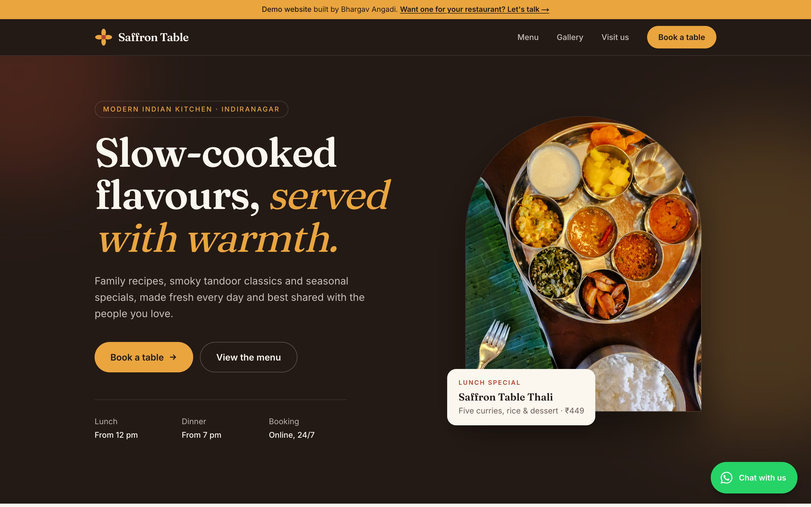
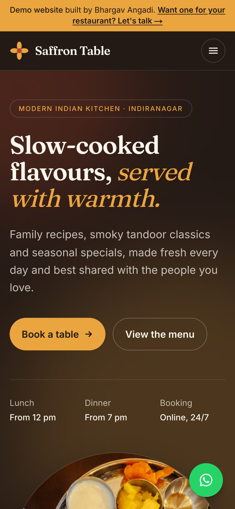
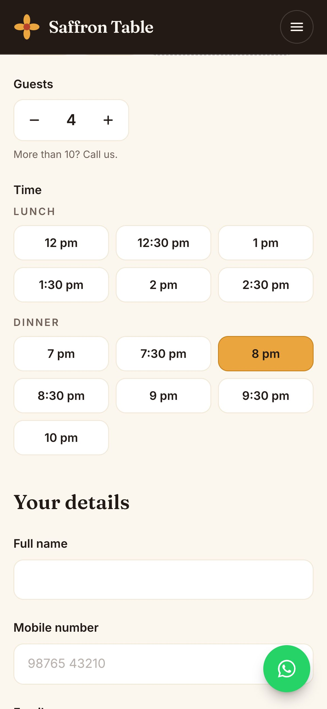
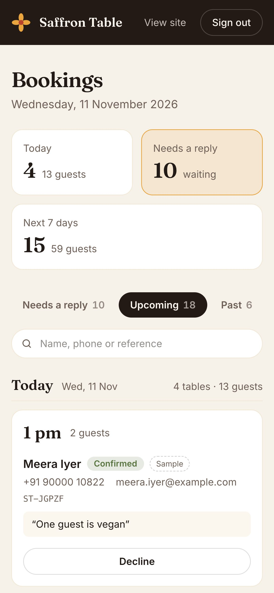
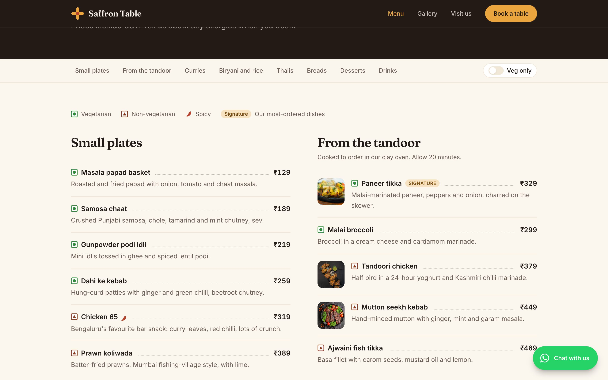
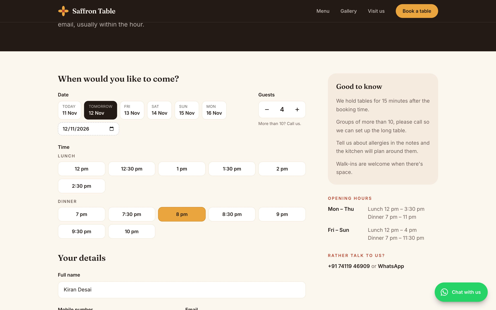
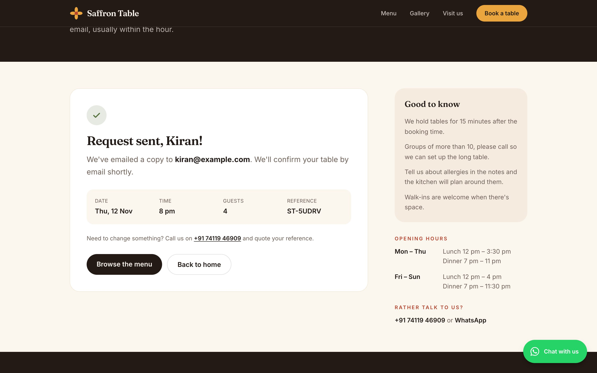
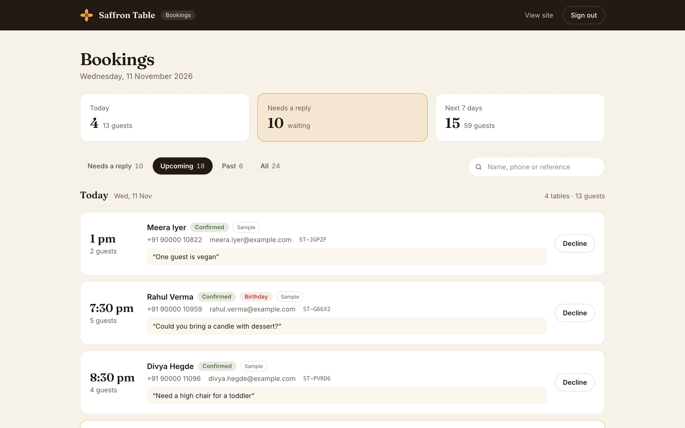
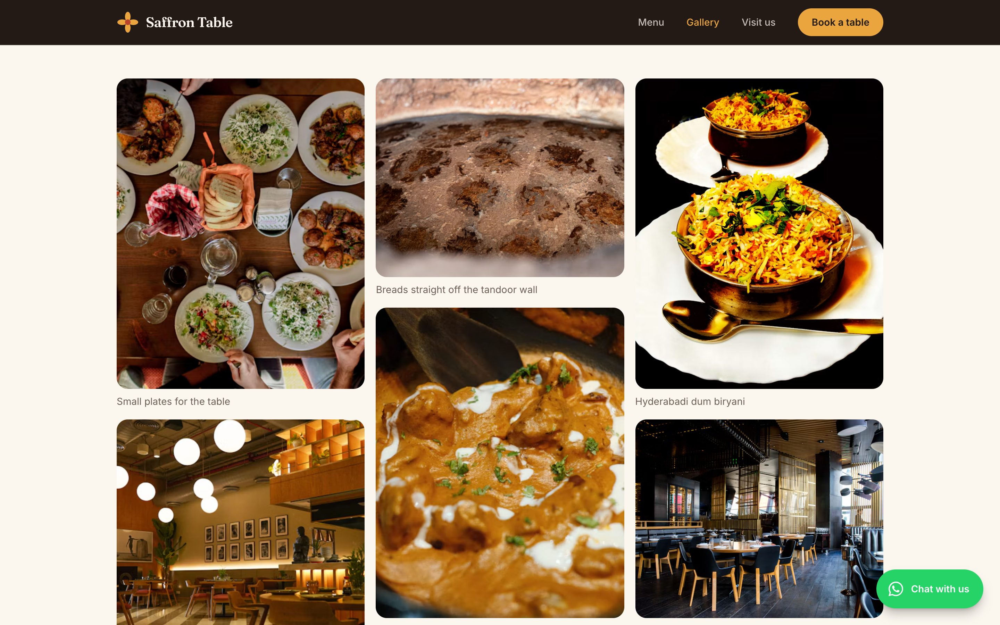
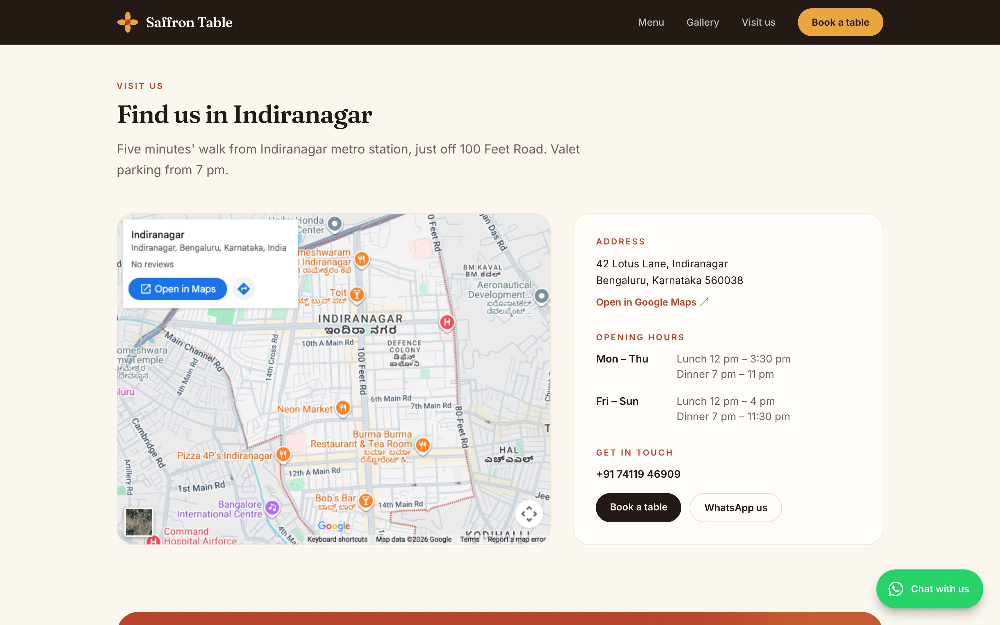

# Saffron Table

A restaurant website with online table booking. Guests pick a time, the restaurant accepts or declines it from a simple admin page, and both sides get an email.



> **This is a portfolio demo.** Saffron Table is a made-up restaurant in Bengaluru. I built the site to show restaurant and café owners the kind of thing I can make for them. The food and interior photos are free stock photos from Unsplash ([credits below](#photo-credits)), the address is fictional, and the phone and WhatsApp links reach me, not a restaurant.

**Live demo:** https://saffron-table-one.vercel.app (bookings admin at [/admin](https://saffron-table-one.vercel.app/admin), password `saffron-demo`)

The live demo has no database attached yet, so bookings made there are kept in temporary storage and cleared from time to time. The sample bookings come back on their own.

## What it does

**For guests**

- Home page with a photo hero, signature dishes, the kitchen's story, a gallery strip, a map and opening hours
- Full menu with categories, prices, veg/non-veg marks, spicy and signature tags, and a veg-only switch
- Photo gallery with a full-screen viewer (arrow keys and Esc work)
- Table booking: pick a date, the number of guests and a time. Times come from the opening hours, and full or past slots are greyed out. Name, mobile number and email are checked as you type, and again on the server.
- An email when the request arrives, and another when it's confirmed or declined
- Floating WhatsApp button and a click-to-call number on every page

**For the restaurant**

- Password-protected `/admin` page showing today's bookings, requests waiting for a reply, and the next 7 days
- Accept or decline in one tap, and the guest is emailed automatically
- Search by name, phone number or booking reference
- An email for every new request, with the guest's details and a link to the admin page

**Search engines and sharing**

- Its own title, description and canonical URL on every page, plus `sitemap.xml` and `robots.txt`
- An Open Graph image generated at build time, so links look good on WhatsApp and social media
- Restaurant structured data (opening hours, address, menu and booking links) on the home page

All the restaurant's details (name, hours, address, phone, booking rules) live in one file, `src/lib/site.ts`, and the menu lives in `src/lib/menu.ts`.

## Screenshots

| Home | Booking | Admin |
| :---: | :---: | :---: |
|  |  |  |

<details>
<summary>More screenshots (desktop)</summary>

**Menu**


**Booking form**


**After sending a request**


**Bookings admin**


**Gallery**


**Map and opening hours**


</details>

## Built with

- [Next.js 16](https://nextjs.org) (App Router) and React 19, in TypeScript
- [Tailwind CSS 4](https://tailwindcss.com)
- Storage: PostgreSQL through [postgres.js](https://github.com/porsager/postgres) (Neon, Supabase or any Postgres), or a local JSON file that needs no setup
- Email: [Resend](https://resend.com)'s HTTP API, or printed to the server log while developing
- Hosting: made for [Vercel](https://vercel.com), runs anywhere Node.js does

## How it holds up

- **Fast pages.** The home, menu, gallery and booking pages are prerendered to static HTML. Photos come straight from Unsplash's image CDN at the width each screen needs, so the server never handles image bytes.
- **No double bookings.** Each time slot has a seat limit. With Postgres, the capacity check and the insert happen in one transaction under a lock for that slot, so two guests can't both get the last table, however many server instances are running.
- **Scales out.** Admin sessions are signed cookies rather than server memory, and rate limits are stored in the database, so you can run as many instances as the traffic needs.
- **Database down?** The pages still load. The booking form tells guests to call or WhatsApp instead, and the admin page explains what's wrong instead of crashing.
- **Security.** Every rule is enforced on the server (the browser checks are only there to help). Sign-in and booking requests are rate limited per visitor, with IP addresses hashed before they're stored. The booking form has a hidden field that catches bots. Responses carry a Content-Security-Policy, HSTS, `X-Frame-Options` and other security headers, and `/admin` is kept out of search results. In production the admin password can be stored as an scrypt hash.

For a real restaurant, pair it with a managed Postgres (Neon or Supabase) with backups turned on, and verify a sending domain in Resend.

## Run it locally

You need Node.js 20 or newer.

```bash
git clone https://github.com/bhargavang/saffron-table.git
cd saffron-table
npm install
cp .env.example .env.local
npm run dev
```

Open http://localhost:3000. Sample bookings are created on the first visit, dated around today, and refreshed automatically when they get old, so the admin page always has something in it.

Without a database or email key, bookings are saved in `.data/bookings.json`, and every email is printed in the terminal and saved as an HTML file in `.data/outbox/` so you can open it in a browser.

### Demo admin login

Go to http://localhost:3000/admin and sign in with:

- **Password:** `saffron-demo`

That password is set in `.env.example`. Change it before putting the site anywhere public.

## Configuration

All settings are environment variables. `.env.example` lists them with notes.

| Variable | What it does |
| --- | --- |
| `ADMIN_PASSWORD` | Admin password, fine for local use |
| `ADMIN_PASSWORD_HASH` | Use instead of `ADMIN_PASSWORD` in production. Create it with `npm run hash-password -- "your-password"` |
| `ADMIN_SESSION_SECRET` | Optional key for signing admin sessions |
| `ADMIN_LOGIN_HINT` | Optional text under the sign-in form, e.g. the demo password |
| `DATABASE_URL` | Postgres connection string. Leave empty to use the local JSON file. Tables are created on first use. |
| `RESEND_API_KEY` | Sends real emails through Resend. Leave empty to print them instead. |
| `EMAIL_FROM` | Sender, e.g. `Saffron Table <bookings@your-domain.com>` |
| `OWNER_EMAIL` | Where new-booking emails go |
| `SITE_URL` | Public address of the site, used in the sitemap and email links |

## Putting it online

1. Import the repo into Vercel.
2. Create a Postgres database on Neon or Supabase and set `DATABASE_URL` to its pooled connection string.
3. Set `ADMIN_PASSWORD_HASH`, `OWNER_EMAIL` and, for real emails, `RESEND_API_KEY` and `EMAIL_FROM`.
4. Deploy.

Without `DATABASE_URL`, Vercel can only keep bookings in temporary storage that gets wiped, which is fine for a quick look but not for real use.

## Reusing it for a real restaurant

1. Change the details in `src/lib/site.ts` and set `demo.show` to `false` to remove the demo banner.
2. Replace the menu in `src/lib/menu.ts`.
3. Swap the photos in `src/lib/photos.ts` for the restaurant's own (files in `public/` work too).
4. Adjust the booking rules in `site.booking`: seats per slot, the largest group that can book online, how far ahead people can book.

## Project structure

```
src/
  app/
    (site)/          public pages: home, menu, gallery, book
    admin/           sign-in and the bookings page
    api/availability GET endpoint the booking form uses
    opengraph-image.tsx, sitemap.ts, robots.ts
  components/        header, footer, hero, menu marks, WhatsApp button…
  lib/
    site.ts          restaurant details, hours and booking rules
    menu.ts          dishes and prices
    photos.ts        photo list and credits
    bookings/        validation, time slots, storage (file or Postgres), demo data
    email/           email templates and sending
    admin-*.ts       password check and signed sessions
  proxy.ts           sends signed-out visitors from /admin to the sign-in page
```

## How I tested it

- `npm run build`, TypeScript and ESLint all pass.
- I went through the booking flow and the admin page in Chrome at phone and desktop sizes, locally and on the live Vercel deployment.
- I ran the Postgres storage against [PGlite](https://pglite.dev) (Postgres compiled to WebAssembly) on my machine: tables were created on the first request, sample data was added, bookings and status changes were saved, and a booking that would have overfilled a slot was turned away. With the database stopped, the pages kept loading and the booking form showed the phone and WhatsApp fallback.
- Not tested yet: a hosted Neon or Supabase database, and sending real email through Resend.

### Lighthouse

Lighthouse 13.6 with its mobile settings (simulated slow 4G on a mid-range phone), run on my Mac against a production build (`npm run build && npm start`) on 11 November 2026:

| Page | Performance | Accessibility | Best practices | SEO |
| --- | :---: | :---: | :---: | :---: |
| Home | 98 | 100 | 100 | 100 |
| Menu | 90 | 100 | 100 | 100 |
| Book a table | 99 | 100 | 100 | 100 |
| Gallery | 93 | 100 | 100 | 100 |

Scores move a few points between runs, and a hosted deployment will score a bit differently.

## Photo credits

All photos are from [Unsplash](https://unsplash.com) and used under the [Unsplash License](https://unsplash.com/license).

- [A full Indian thali with curries, rice and breads, seen from above](https://unsplash.com/photos/delicious-indian-meal-served-on-a-platter-4pT9e68P_mU) by [Zoshua Colah](https://unsplash.com/@zoshuacolah)
- [Butter chicken in a rich orange gravy, topped with cream and coriander](https://unsplash.com/photos/brown-and-green-dish-on-brown-wooden-bowl-sqcH2q7lkvo) by [Raman](https://unsplash.com/@potofgold07)
- [Two plates of chicken biryani on a dark table](https://unsplash.com/photos/two-plates-of-food-on-a-black-table-o5XB6XwTb1I) by [Omkar Jadhav](https://unsplash.com/@jadhav24omkar)
- [Paneer tikka with charred peppers and onions on a sizzler plate](https://unsplash.com/photos/cooked-foods-WmKXu-bzygo) by [Viktor Forgacs](https://unsplash.com/@sonance)
- [A stack of freshly baked naan on a wooden board](https://unsplash.com/photos/a-pile-of-pita-bread-sitting-on-top-of-a-wooden-cutting-board--C93EET79kU) by [Sweetyoga Justine](https://unsplash.com/@sweetyogajustine)
- [Soft rotis stacked on a plate](https://unsplash.com/photos/a-plate-of-food-WrE3ruckrwI) by [Ajeet Panesar](https://unsplash.com/@ajeetpanesarphotography)
- [Tandoori chicken pieces on a slate with mint chutney and onion rings](https://unsplash.com/photos/a-tray-of-chicken-wings-with-a-side-of-dipping-sauce-R25pvpErlsI) by [Madhurima Basak](https://unsplash.com/@bskmadhu_15)
- [Masala chai being poured into small clay cups](https://unsplash.com/photos/person-pouring-tea-into-small-clay-cups-gXYwwTQ_tZw) by [Ajoy Das](https://unsplash.com/@champsara)
- [Dal makhani in a black pot with a swirl of cream](https://unsplash.com/photos/dal-makhani-in-black-pot-WR13Tw8gmsA) by [Chetanya Sharma](https://unsplash.com/@chetanya_designs)
- [Seekh kebabs on a plate with grilled tomatoes and fresh herbs](https://unsplash.com/photos/a-plate-of-meat-and-vegetables-on-a-table-dIbPZcftpL8) by [Parnis Azimi](https://unsplash.com/@parnissazimi)
- [Saffron phirni served in a clay pot](https://unsplash.com/photos/a-close-up-of-a-bowl-of-soup-on-a-table-j1ZG-vIiApI) by [Ashraful Islam](https://unsplash.com/@ashraful25)
- [A table spread with small plates of Indian dishes, seen from above](https://unsplash.com/photos/white-plates-with-assorted-foods-Q_Moi2xjieU) by [Stefan Vladimirov](https://unsplash.com/@skv_creates)
- [Dining room with wooden tables, soft lamps and a long bar](https://unsplash.com/photos/photo-of-pub-set-in-room-during-daytime-poI7DelFiVA) by [Jason Leung](https://unsplash.com/@ninjason)
- [Restaurant interior with warm string lights over the tables](https://unsplash.com/photos/a-restaurant-with-a-lot-of-tables-and-chairs-ZEfHrVDF3NM) by [Mustafa Fatemi](https://unsplash.com/@solaticace)
- [A warm, wood-panelled dining room laid for dinner](https://unsplash.com/photos/a-room-with-tables-and-chairs-e4B5AvA7Jqo) by [Glenov Brankovic](https://unsplash.com/@glenovbrankovic)
- [A chef cooking over a tall flame in a busy kitchen](https://unsplash.com/photos/man-in-black-shirt-wearing-white-mask-12xmsDaAO6I) by [Charanjeet Dhiman](https://unsplash.com/@charanjeet_dhiman)
- [A chef in whites finishing a dish at the pass](https://unsplash.com/photos/man-in-white-chef-uniform-cooking-9xObRZdEN7g) by [Charanjeet Dhiman](https://unsplash.com/@charanjeet_dhiman)
- [Breads baking on the wall of a clay tandoor](https://unsplash.com/photos/tandoor-oven-interior-with-charred-spots-D3bA0xwSWus) by [Bernd Dittrich](https://unsplash.com/@hdbernd)

Built by [Bhargav Angadi](https://github.com/bhargavang), freelance web developer in Bengaluru. Want something like this for your business? Email bhargav.angadi@gmail.com or [message me on WhatsApp](https://wa.me/917411946909).
